# Bouncy Button

[](https://pub.dev/packages/bouncy_button)
[](https://github.com/Ibrahim-Lokman/bouncy_button/actions/workflows/ci.yml)
[](https://github.com/Ibrahim-Lokman/bouncy_button/blob/main/LICENSE)

**Buttons people want to press.** Bouncy Button gives your Flutter app a tactile 3D button that sinks when tapped and springs back when released. It also handles the hard parts of real buttons for you: loading states, accidental double taps, and accessibility.

<p>
  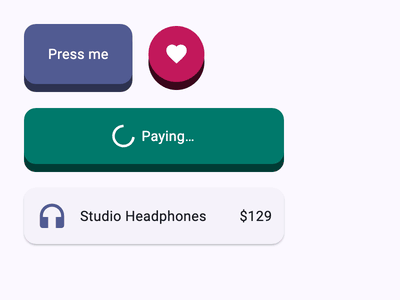
  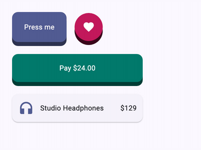
</p>

## Why Bouncy Button

- **It feels real.** The button face sits on a darker layer, like a key on a keyboard, and sinks into it when pressed. Even the quickest tap shows the full press.
- **It's safe for real actions.** Give it a function that saves or pays, and it shows a spinner, then a tick or an error. It ignores extra taps while it works, so nothing is sent twice.
- **It works with what you already have.** Add the same press to any card or image, or add double-tap protection to the Material and Cupertino buttons you already use.
- **It's accessible out of the box.** Screen readers, keyboards, large text, and the "reduce motion" setting all work with no extra code. In debug builds, it also warns you about common mistakes, such as a missing label or hard-to-read colors.
- **It's light.** No dependencies outside the Flutter SDK, and it runs on Android, iOS, web, macOS, Windows, and Linux.

## Getting started

Add the package:

```sh
flutter pub add bouncy_button
```

Or add it to `pubspec.yaml` yourself:

```yaml
dependencies:
  bouncy_button: ^2.2.0
```

Then use it like any button:

```dart
import 'package:bouncy_button/bouncy_button.dart';

BouncyButton(
  onPressed: () => print('Pressed!'),
  child: const Text('Press me'),
)
```

With no other settings, every button already:

- uses your theme's main color, and picks a readable text color, in light and dark mode
- gives a light vibration when tapped, on phones that support it
- tells screen readers it's a button, and reads its label
- can be reached with Tab and pressed with Enter or Space, with a visible focus ring
- grows to fit large system text instead of cutting words off
- moves instantly instead of animating when the system asks for reduced motion

Every screenshot and animation below comes from the **Features** tab of the [example app](#example-app), where you can try each one.

## Features

1. [The 3D press](#the-3d-press)
2. [Loading, success, and error](#loading-success-and-error)
3. [No accidental double taps](#no-accidental-double-taps)
4. [The bounce on any widget](#the-bounce-on-any-widget)
5. [Springy, lively motion](#springy-lively-motion)
6. [Press animations](#press-animations)
7. [A style for every action](#a-style-for-every-action)
8. [Timeouts and confirmation](#timeouts-and-confirmation)
9. [Protect the buttons you already have](#protect-the-buttons-you-already-have)
10. [Button groups](#button-groups)
11. [Glass buttons](#glass-buttons)
12. [Built for everyone](#built-for-everyone)
13. [Catch mistakes early](#catch-mistakes-early)
14. [Press from code, one at a time](#press-from-code-one-at-a-time)
15. [Style your whole app at once](#style-your-whole-app-at-once)
16. [Colors, gradients, and custom looks](#colors-gradients-and-custom-looks)
17. [Haptics and sound](#haptics-and-sound)
18. [Test your buttons](#test-your-buttons)

Then the [complete reference](#complete-reference) lists every option, with its default.

### The 3D press

<p>
  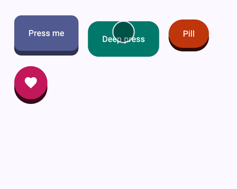
  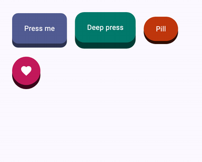
</p>

**What it does:** every button has two layers, the face you see and a darker layer underneath that gives it depth. Pressing pushes the face down into that layer, and letting go lets it spring back up. A tap that's over in an instant still shows the whole press, so every tap feels like it registered.

**When it helps:** for the main action on a screen, in games and apps for children, or anywhere you want buttons to feel physical.

**How to use it:**

```dart
BouncyButton(
  onPressed: () {},
  style: BouncyButtonStyle(
    backgroundColor: Colors.teal.shade700,
    elevation: 12, // How deep the press goes
    borderRadius: BorderRadius.circular(18),
  ),
  child: const Text('Deep press'),
)
```

**Out of the box:** a face at least 60 pixels tall with 8 pixels of depth, rounded corners of 12, and your theme's main color. The layer underneath is a darker shade of the face. Sliding your finger off the button cancels the press, like Material buttons.

**What you can change:**

| Option | What it changes | Default |
| --- | --- | --- |
| `style.elevation` | How deep the press goes, in pixels | `8` |
| `style.backgroundColor` | The face color | Theme's primary color, for a filled face |
| `style.foregroundColor` | Text and icon color | Picked to be readable on the face |
| `style.shadowColor` | The color of the layer underneath | A darker shade of the face. Outlined: the border color |
| `style.shadowDarkness` | How much darker that layer is, from 0 to 1. `BouncyButtonStyle.shadowLight` is 0.12 | `0.3` (`shadowDark`) |
| `style.borderRadius`, `style.shape` | Corners, or a circle | 12, rectangle |
| `style.height`, `style.width` | Smallest height, and width | 60, fits the label |
| `BouncyButton.primary`, `.secondary`, `.tertiary` | Ready-made sizes: 56, 48, and 46 tall | Theme styles, if set |

### Loading, success, and error

<p>
  
  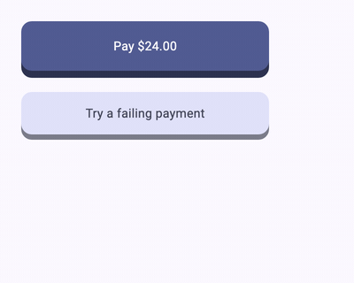
</p>

**What it does:** give the button an async function with `onPressedAsync`. It shows a spinner while your code runs, then a tick when it's done, or an error icon and a small shake if your code throws. While it's busy, extra taps are ignored, and the button keeps its size, so nothing around it jumps.

**When it helps:** paying, saving a form, signing in, sending a message, or anything that waits for a server.

**How to use it:**

```dart
BouncyButton(
  onPressedAsync: () => api.placeOrder(cart),
  onError: (error, stackTrace) => showMessage('Payment failed'),
  feedback: const BouncyButtonFeedback(
    loadingText: 'Paying…',                          // Shown next to the spinner
    minLoadingDuration: Duration(milliseconds: 400), // No flicker on fast networks
  ),
  child: const Text(r'Pay $24.00'),
)
```

**Out of the box:**
- **While working:** a spinner in the button's text color.
- **Results:** a tick for 1.2 seconds on success. An error icon for 1.2 seconds on failure, with a shake unless reduce motion is on.
- **Screen readers** hear "Loading", "Done", and "Failed".
- **Errors:** if your code throws and you haven't set `onError`, the error goes to Flutter's error log, so it's never silently lost.
- **Haptics:** a soft tick on success and a stronger buzz on failure, if haptics are on.

**What you can change:**

| Option | What it changes | Default |
| --- | --- | --- |
| `feedback.loadingText` | Text next to the spinner, also read by screen readers | None, just the spinner |
| `feedback.loadingBuilder`, `successBuilder`, `errorBuilder` | Your own loading, success, and error content | Spinner, tick, and error icon |
| `feedback.showSuccess`, `showError` | Whether to show each result, or go straight back to the label | `true` |
| `feedback.shakeOnError` | The shake on failure | `true` |
| `feedback.resultDuration` | How long the tick or error stays | 1.2 seconds |
| `feedback.minLoadingDuration` | The shortest time loading shows, so it doesn't flash | 0 |
| `feedback.loadingLabel`, `successLabel`, `errorLabel` | What screen readers say. Translate these for your app | "Loading", "Done", "Failed" |
| `onError` | What happens when your code throws | Reported to Flutter |
| `isLoading` | Shows loading when you track it yourself | None |

### No accidental double taps

<p>
  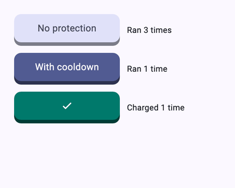
  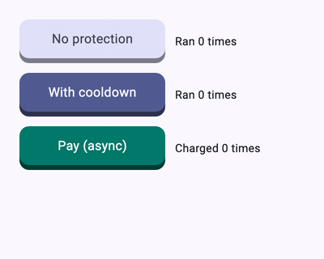
</p>

**What it does:** people tap twice out of habit, and slow networks make it worse. An async button ignores taps while it works, even two in the same instant. For a plain button, set a `cooldown`, and it ignores taps for that long after each use. Holding Enter or Space presses a button once, not over and over.

**When it helps:** opening a page, which would otherwise open twice; submitting a form; liking a post; and, most of all, paying.

**How to use it:**

```dart
BouncyButton(
  onPressed: () => Navigator.of(context).push(route),
  cooldown: const Duration(milliseconds: 600),
  child: const Text('Open'),
)
```

**Out of the box:** `onPressedAsync` buttons are always protected while they run. A plain `onPressed` has no cooldown, because some buttons, like a counter, are meant to be tapped quickly.

**What you can change:**

| Option | What it changes | Default |
| --- | --- | --- |
| `cooldown` | How long to ignore taps after each use. For `onPressedAsync`, it starts once the button is ready again. Also on `BouncyPressable` and `BouncyAsyncBuilder` | None |

Two tips:

- **Enter in a text field:** call `controller.press()` from `onSubmitted`, through a `BouncyButtonController`. Enter and taps then share the same protection.
- **Payments:** the button stops repeated taps, but not a retry after a timeout, or a second device. Send an idempotency key with the request, created once per order, so your server charges only once. The example app's Checkout tab shows how.

### The bounce on any widget

<p>
  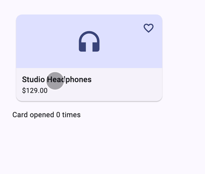
  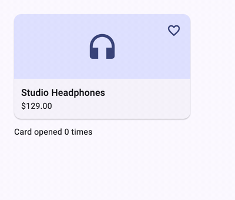
</p>

**What it does:** `BouncyPressable` gives any widget the same satisfying press. It shrinks slightly while held and springs back on release. When one sits inside another, such as a heart button on a card, only the one you touch reacts.

**When it helps:** product cards, photos, list items, tiles, and your own custom buttons.

**How to use it:**

```dart
BouncyPressable(
  onTap: () => openProduct(product),
  child: ProductCard(product),
)
```

**Out of the box:**
- **Press:** shrinks to 95% in 120 milliseconds.
- **Keyboard:** Enter and Space press it, and keyboard focus shows a 2 pixel blue ring, thicker in high contrast mode.
- **Mouse:** shows a pointing-hand cursor.
- **Screen readers:** announce it as a button.
- **Haptics:** none.
- **Material:** it needs none. Import `package:bouncy_button/pressable.dart` if you'd rather avoid Material.

**What you can change:**

| Option | What it changes | Default |
| --- | --- | --- |
| `scaleFactor` | How small it gets, from 0 to 1 | `0.95` |
| `duration`, `reverseDuration` | Press and release speed | 120 ms, same as press |
| `curve`, `reverseCurve` | Press and release feel | `Curves.easeOut`, same as press |
| `spring` | Spring physics instead of the curves | None |
| `haptic` | A vibration on press | None |
| `cooldown` | Ignores taps for a while after each use | None |
| `semanticsButton` | Set to `false` when the child holds other controls, so screen readers reach each one | `true` |
| `semanticLabel` | Extra text for screen readers | None |
| `focusColor`, `focusBorderRadius` | The keyboard focus ring | Blue, 8 |
| `onLongPress`, `onTapDown`, `onTapUp`, `onTapCancel` | More touch callbacks | None |

### Springy, lively motion

<p>
  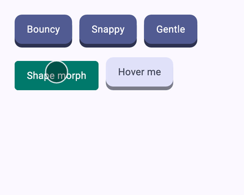
  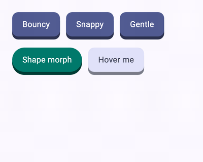
</p>

**What it does:**
- **Springs:** the button moves the way a real spring does. Press again while it's still rising, and it turns around smoothly instead of starting over.
- **Shape:** the corners can change while pressed, for example from a pill to a rounded square.
- **Hover:** on desktop and web, the button rises a little under the mouse.

**When it helps:** playful apps, games, and anywhere you want motion to feel alive rather than mechanical.

**How to use it:**

```dart
BouncyButton(
  onPressed: () {},
  animation: const BouncyButtonAnimation(spring: BouncyPressSpring.bouncy),
  style: BouncyButtonStyle(
    borderRadius: BorderRadius.circular(28),
    pressedBorderRadius: BorderRadius.circular(6), // Square while pressed
  ),
  child: const Text('Shape morph'),
)
```

**Out of the box:** no spring and no shape change, just a quick 70 millisecond press. Hover lifts the face by 2 pixels, with a mouse only. With "reduce motion" turned on, buttons move instantly instead of animating: the face still sinks while held, but there's no spring, hover lift, or error shake.

**What you can change:**

| Option | What it changes | Default |
| --- | --- | --- |
| `animation.spring` | Spring physics. Try `BouncyPressSpring.bouncy`, `snappy`, or `gentle` | None |
| `BouncyPressSpring(stiffness, dampingRatio, mass)` | Your own spring: how strong, how bouncy, and how heavy | `500`, `0.5`, `1` |
| `style.pressedBorderRadius` | The corners while fully pressed | No change |
| `interaction.hoverLift` | How far the face rises under a mouse, in pixels. `0` turns it off | `2` |

### Press animations

<p>
  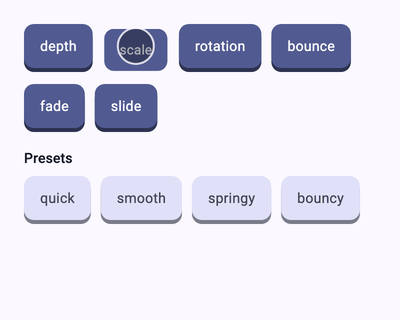
  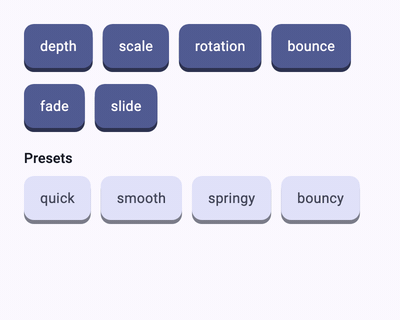
</p>

**What it does:** besides sinking, a button can shrink, tilt, bounce, fade, or slide as it's pressed. Ready-made presets set the timing for you.

**When it helps:** to match your app's personality, or to make one button stand out.

**How to use it:**

```dart
BouncyButton(
  onPressed: () {},
  animation: const BouncyButtonAnimation(
    type: BouncyButtonAnimationType.scale,
    duration: Duration(milliseconds: 150),
  ),
  child: const Text('Scale'),
)
```

**Out of the box:** `depth`, which only sinks, in 70 milliseconds with an ease-in-out curve.

**What you can change:**

| Option | What it changes | Default |
| --- | --- | --- |
| `type: depth` | Only sinks into the layer below | Yes |
| `type: scale` | Also shrinks, to `scaleAmount` | |
| `type: rotation` | Also tilts, by `rotationAngle` | |
| `type: bounce` | Also shrinks. Pair it with a release curve that overshoots, as the `bouncy` preset does | |
| `type: fade` | Also fades, to 80% | |
| `type: slide` | Also nudges 2 pixels sideways | |
| `duration`, `reverseDuration` | Press and release speed | 70 ms, same as press |
| `curve`, `reverseCurve` | Press and release feel | `Curves.easeInOut`, same as press |
| `scaleAmount` | How small `scale` and `bounce` get | `0.95` |
| `rotationAngle` | How far `rotation` tilts, in radians | `0.03` |
| `animateOpacity` | Fades a disabled button to 60%, smoothly | `false` |
| Presets | `BouncyButtonAnimation.quick` (50 ms), `smooth` (150 ms), `springy` (a bouncy spring), `bouncy` (springs past its rest on release) | |

### A style for every action

<p>
  
  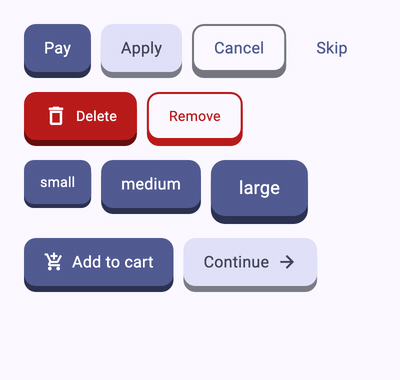
</p>

**What it does:** most screens have one main action and a few smaller ones. There's a fill for each, so the most important button stands out, plus a red tone for deleting, three sizes, and icons on either side of the label.

**When it helps:** on any screen with more than one button.

| Use it for | Style | Looks like |
| --- | --- | --- |
| The main action, such as **Pay** | `BouncyButtonStyle.primary` | Solid color |
| Secondary actions, such as **Apply** | `BouncyButtonStyle.tonal` | Softer color |
| Minor actions, such as **Cancel** | `BouncyButtonStyle.outlined` or `ghost` | A colored outline on a plain face, or text only |
| Deleting something | `BouncyButtonStyle.destructive` | Your theme's error red |

**How to use it:**

```dart
BouncyButton(
  onPressed: deleteAccount,
  style: BouncyButtonStyle.destructive,
  leading: const Icon(Icons.delete_outline),
  child: const Text('Delete account'),
)
```

**Out of the box:** a filled face in your theme's main color. The destructive tone uses your theme's error colors with every fill. Ghost and glass buttons have no depth.

**What you can change:**

| Option | What it changes | Default |
| --- | --- | --- |
| `style.fill` | `filled`, `tonal`, `outlined`, `ghost`, or `glass` | `filled` |
| `style.tone` | `normal`, or `destructive` for red | `normal` |
| `BouncyButtonStyle.fromSize(...)` | `small`, `medium`, or `large`: 44, 48, or 56 tall, with matching depth, padding, text, and icons. Even small is easy to tap | |
| `leading`, `trailing` | An icon before or after the label, on the correct side for right-to-left languages | None |
| `gap` | Space between icons and label | `8` |
| `style.minWidth` | Smallest width. Unlike `width`, longer labels still fit | None |
| `style.width` | Fixed width. `double.infinity` fills the space | Fits the label |
| `style.padding` | Space inside the button | 24 sideways, 12 up and down |
| `style.textStyle`, `style.iconSize` | Text style and icon size | Theme's |
| `BouncyButtonStyle.simple(...)` | A quick style from a color, size, corners, and depth | |

Mix styles with `copyWith`, for example `BouncyButtonStyle.destructive.copyWith(fill: BouncyButtonFill.outlined)` for a red outlined button.

### Timeouts and confirmation

<p>
  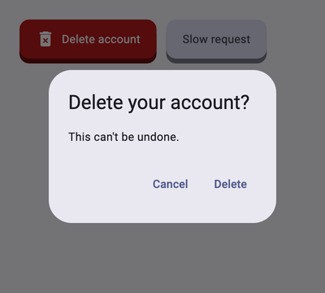
  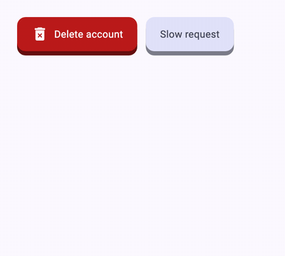
</p>

**What it does:**
- **Timeout:** a request that never answers leaves a spinner turning forever. With `timeout`, the button gives up after that long: it shows the error, and can be pressed again.
- **Confirm:** for actions that can't be undone, `confirm` asks first, and the action runs only if it returns `true`. While your dialog is open, the button ignores taps, so a double tap can't open two dialogs.

**When it helps:**
- **Timeout:** for payments and uploads on weak connections.
- **Confirm:** for deleting an account, clearing a cart, or signing out.

**How to use it:**

```dart
BouncyButton(
  onPressedAsync: () => api.deleteAccount(),
  timeout: const Duration(seconds: 15),
  confirm: () async =>
      await showDialog<bool>(context: context, builder: confirmDialog) ?? false,
  style: BouncyButtonStyle.destructive,
  child: const Text('Delete account'),
)
```

**Out of the box:** no timeout, and no question. When a timeout happens, `onError` receives a `TimeoutException`. The action itself keeps running, because Dart can't stop it, but its result is ignored.

**What you can change:**

| Option | What it changes | Default |
| --- | --- | --- |
| `timeout` | How long an async action may run | None |
| `confirm` | A question to ask first. It also works with a plain `onPressed`, and from a controller | None |

Both also work on `BouncyAsyncBuilder`.

### Protect the buttons you already have

<p>
  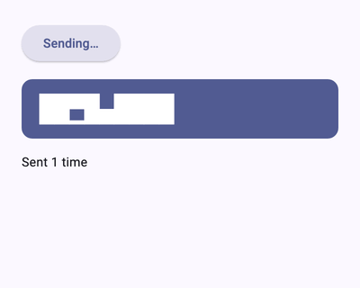
  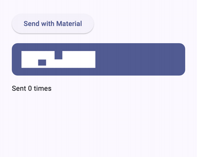
</p>

**What it does:** `BouncyAsyncBuilder` gives the buttons you already use the same protection and states, without changing how they look. It hands your button a guarded callback and the current status.

**When it helps:** when your design system has its own buttons, or you use Material or Cupertino buttons and just want them safe.

**How to use it:**

```dart
BouncyAsyncBuilder(
  onPressed: () => api.send(message),
  builder: (context, onPressed, status) => ElevatedButton(
    onPressed: onPressed,
    child: Text(status == BouncyButtonStatus.loading ? 'Sending…' : 'Send'),
  ),
)
```

**Out of the box:**
- **Repeat taps** are blocked instantly, even two in the same instant.
- **Focus:** the callback stays usable while busy, so the button keeps its enabled look and keyboard focus.
- **Screen readers** hear loading, success, and failure.

**What you can change:**

| Option | What it changes | Default |
| --- | --- | --- |
| `disableWhileBusy` | Passes a null callback while busy, so the button looks disabled. It loses keyboard focus | `false` |
| `feedback` | How long results last, the minimum loading time, and what screen readers say. Its builders aren't used | Built-in. The theme's `defaultFeedback` isn't used |
| `onError`, `cooldown`, `controller`, `timeout`, `confirm` | The same as on `BouncyButton` | None |
| `announceStatus` | Whether screen readers hear status changes. Turn off if `builder` returns several controls | `true` |

### Button groups

<p>
  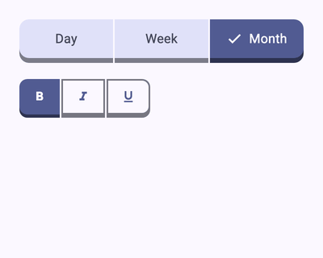
  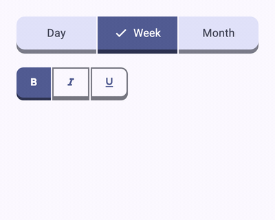
</p>

**What it does:** a row of connected buttons for picking one option, like Day, Week, or Month, or several, like bold and italic.

**When it helps:** filters, view switchers, formatting toolbars, and settings with a few choices.

**How to use it:**

```dart
BouncyButtonGroup<String>(
  segments: const [
    BouncyButtonSegment(value: 'day', label: Text('Day')),
    BouncyButtonSegment(value: 'week', label: Text('Week')),
    BouncyButtonSegment(value: 'month', label: Text('Month')),
  ],
  selected: {view},
  onSelectionChanged: (selection) => setState(() => view = selection.first),
)
```

**Out of the box:**
- **Look:** selected segments are filled and the rest are tonal. Only the outer corners are round, on the correct side for right-to-left languages.
- **Selection:** you can't deselect the last segment.
- **Screen readers** hear each segment as checked or not checked.

**What you can change:**

| Option | What it changes | Default |
| --- | --- | --- |
| `multiSelect` | Allows more than one | `false` |
| `emptySelectionAllowed` | Allows deselecting the last one | `false` |
| `showSelectedIcon`, `selectedIcon` | A check on selected segments, for people who can't easily tell the colors apart | Off, a check mark |
| `style`, `selectedStyle` | Unselected and selected looks | Medium tonal, and filled |
| `spacing` | The gap between segments | `2` |
| `expand` | Whether segments share the width equally | `true` |
| `interaction` | Haptics and highlights | A selection click |
| `BouncyButtonSegment(icon, enabled, semanticLabel)` | An icon, turning one segment off, and a screen reader label for icon-only segments | None, `true`, None |

### Glass buttons

<p>
  
  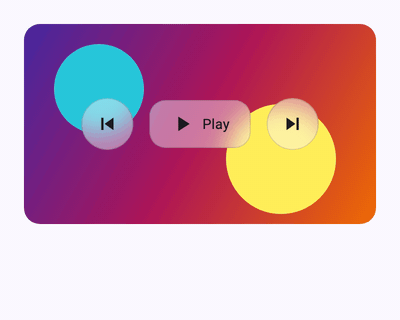
</p>

**What it does:** a frosted, see-through face that blurs what's behind it.

**When it helps:** over photos, video, maps, or colorful backgrounds, such as media player controls.

**How to use it:**

```dart
BouncyButton(
  onPressed: play,
  style: BouncyButtonStyle.glass,
  leading: const Icon(Icons.play_arrow),
  child: const Text('Play'),
)
```

**Out of the box:**
- **Look:** a light, translucent tint of your theme's surface color, with no depth.
- **Press:** a soft tint, since there's no depth to push into.
- **High contrast:** the face turns solid, so its text stays readable.

**What you can change:** `style.backgroundColor` sets the tint. The blur has a cost, so avoid glass in long scrolling lists.

### Built for everyone

<p>
  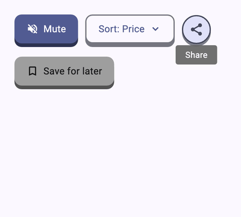
  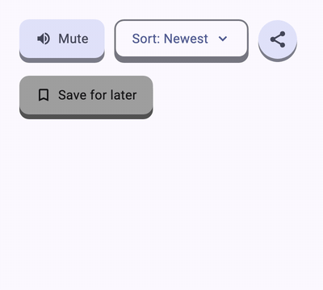
</p>

**What it does:** these work automatically, with no extra code:
- **Screen readers** announce each button, its label, and its loading, success, and error states, as one item rather than three.
- **Keyboards:** Tab moves between buttons, and Enter or Space presses them, once even when held down. A focus ring shows where you are, thicker in high contrast mode, and tooltips appear on keyboard focus.
- **Large text:** buttons grow to fit bigger system fonts instead of cutting words off.
- **Reduce motion** is respected.
- **Right to left:** icons and corners swap sides.

A few options tell people more.

**When it helps:** for everyone who uses a screen reader, a keyboard, voice control, or large text, and in app stores that review accessibility.

**How to use it:**

```dart
BouncyButton(
  isSelected: muted,                 // Screen readers hear "Mute, checked"
  onPressed: () => setState(() => muted = !muted),
  child: const Text('Mute'),          // Keep the same label in both states
)

BouncyButton.icon(
  onPressed: share,
  tooltip: 'Share',                   // Required: an icon alone has no name
  icon: const Icon(Icons.share),
)
```

**Out of the box:** every button is announced and reachable as described above. An icon-only button made with `BouncyButton.icon` is round, with a tap area of at least 48 by 48.

**What you can change:**

| Option | What it changes | Default |
| --- | --- | --- |
| `BouncyButton.icon(tooltip: ...)` | A button with just an icon, named by its tooltip | |
| `tooltip` | A name shown on hover, long press, and keyboard focus, and read by screen readers | None |
| `isSelected` | Makes a toggle, announced as checked or not checked | Not a toggle |
| `expanded` | Tells screen readers whether the menu the button opens is showing | Opens nothing |
| `disabledReason` | Explains why a disabled button can't be used, as a tooltip and to screen readers | None |
| `semanticLabel` | Replaces the label screen readers read. Include the visible text, so voice control still works | The child's text |
| `style.minTapTarget` | A larger tap area for a small button, without changing its look | The button's own size |
| `focusNode`, `autofocus` | Keyboard focus control | None, `false` |
| `statesController` | Follows pressed, hovered, focused, disabled, and selected, for your own visuals or tests | None |

### Catch mistakes early

<p>
  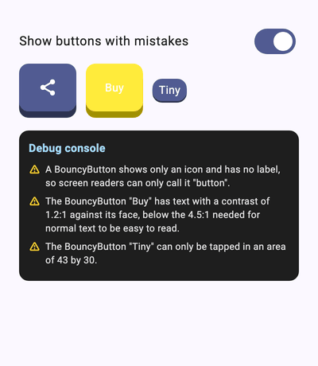
  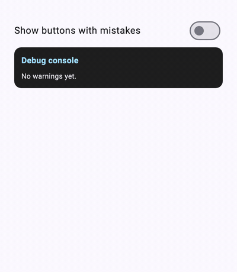
</p>

**What it does:** in debug builds, Bouncy Button prints a warning in your console when a button will be hard to use. Each warning says how to fix it, and appears only once. The example app shows them on screen, as above. It warns about:
- **An icon-only button with no label,** which screen readers can only call "button".
- **Hard-to-read text:** contrast below what accessibility guidelines ask for.
- **A small tap area:** smaller than 48 by 48, or 44 by 44 on iPhone, iPad, and Mac.
- **A label that leaves out the visible text,** which breaks voice control.
- **Another tappable widget inside a button.**
- **A toggle whose text changes with its state.**
- **English screen reader labels in a translated app.**

**When it helps:** while you build, before your users find the problems.

**How to use it:** nothing to do. The checks run in debug builds, and release builds leave them out.

**What you can change:**

| Option | What it changes | Default |
| --- | --- | --- |
| `debugBouncyChecksEnabled` | Set it to `false`, for example in `main`, to turn all the warnings off | `true` |

### Press from code, one at a time

<p>
  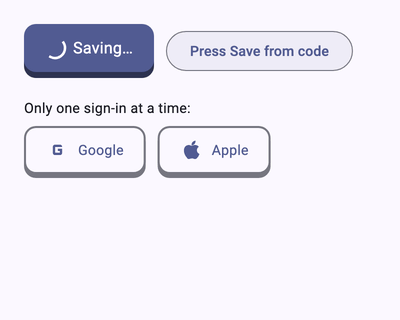
  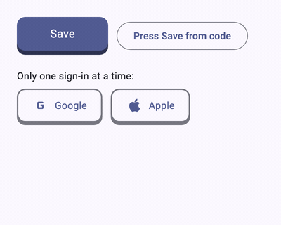
</p>

**What it does:**
- **Press from code:** a `BouncyButtonController` presses a button for you, with its animation and loading, resets it, or tells you its status.
- **One at a time:** `BouncyExclusiveScope` lets only one action below it run, so "Sign in with Google" and "Sign in with Apple" can't run together.

**When it helps:**
- **Controller:** keyboard shortcuts, onboarding tours, and pressing Enter in a form.
- **Scope:** groups of actions that must not overlap.

**How to use it:**

```dart
final save = BouncyButtonController(); // Dispose it with your widget

BouncyButton(controller: save, onPressedAsync: saveDraft, child: const Text('Save'))
// Elsewhere:
await save.press();

BouncyExclusiveScope(
  lockDuringLoading: true,
  child: Column(children: [googleButton, appleButton]),
)
```

**Out of the box:**
- **Scope:** without `lockDuringLoading`, it only stops two buttons being pressed at the same moment, such as with two fingers.
- **Controller:** `press()` does nothing while the button is disabled or cooling down.

**What you can change:**

| Option | What it changes | Default |
| --- | --- | --- |
| `controller.press()` | Presses the button, and completes when its action finishes | |
| `controller.reset()` | Returns the button to normal at once | |
| `controller.status` | `idle`, `loading`, `success`, or `error`. Listen to the controller to follow it | `idle` |
| `controller.isAttached` | Whether a button is using it | |
| `lockDuringLoading` | Lets only one async action in the scope run at a time | `false` |

### Style your whole app at once

<p>
  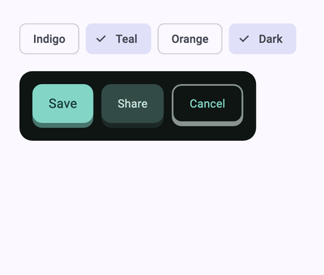
  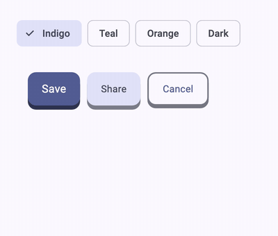
</p>

**What it does:** buttons take their colors from your app's theme, so a new brand color or dark mode changes all of them. Set your button styles once in the theme, too, and every button follows.

**When it helps:** every app, and especially apps with brand colors or dark mode.

**How to use it:**

```dart
MaterialApp(
  theme: ThemeData(
    colorSchemeSeed: Colors.teal,
    extensions: const [
      BouncyButtonTheme(
        primaryStyle: BouncyButtonStyle(elevation: 6),
        defaultAnimation: BouncyButtonAnimation.smooth,
      ),
    ],
  ),
)
```

**Out of the box:** with no theme extension, buttons use the built-in styles in your theme's colors. Anything you pass to a single button wins over the theme.

**What you can change:**

| Option | What it changes | Default |
| --- | --- | --- |
| `primaryStyle` | Style of `BouncyButton` and `BouncyButton.primary` | Built-in |
| `secondaryStyle`, `tertiaryStyle`, `iconStyle` | Style of `.secondary`, `.tertiary`, and `.icon` | Built-in |
| `defaultAnimation`, `defaultInteraction`, `defaultFeedback` | Animation, haptics and highlights, and loading feedback for every `BouncyButton`. Group segments use the group's own `interaction`, and `BouncyAsyncBuilder` its own `feedback` | Built-in |
| `BouncyButtonScope(theme: ...)` | The same theme without the Material `Theme`, for apps using Flutter's newer `material_ui` package | None |

### Colors, gradients, and custom looks

<p>
  
  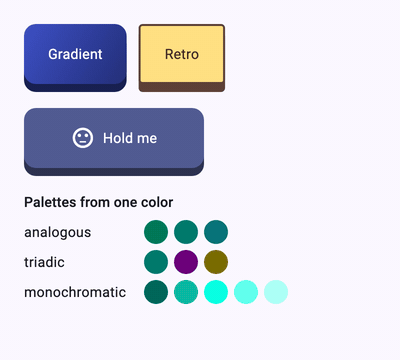
</p>

**What it does:** go beyond the built-in styles with gradients, borders, shadows, your own decoration, or content that changes while the button is held. The `BouncyButtonColors` helpers build matching colors from one color.

**When it helps:** for brand styles, special promotions, and games.

**How to use it:**

```dart
BouncyButton(
  onPressed: () {},
  style: BouncyButtonStyle(
    gradient: BouncyButtonColors.gradientFromColor(Colors.indigo),
  ),
  builder: (context, isPressed) => Padding(
    padding: const EdgeInsets.all(16),
    child: Text(isPressed ? 'Release me' : 'Hold me'),
  ),
  child: const SizedBox.shrink(), // Not used with a builder
)
```

**Out of the box:** a solid color, with a depth layer generated from it.

**What you can change:**

| Option | What it changes | Default |
| --- | --- | --- |
| `style.gradient`, `style.disabledGradient` | A gradient face, and its look when disabled | None, a darker version |
| `style.border`, `style.shadow`, `style.shadows` | A border, and soft shadows | None |
| `style.hslColor` | The face color as HSL | None |
| `style.decoration`, `style.shadowDecoration` | Full control of the face and the layer underneath | None |
| `style.opacity`, `style.transform`, `style.margin`, `style.clipBehavior`, `style.alignment` | Transparency, rotating or skewing, outside space, clipping, and where the content sits | 1, none, none, none, center |
| `builder` | Your own content, told whether the button is pressed | None |
| `BouncyButtonColors` | `gradientFromColor`, `darken`, `lighten`, `complementary`, `analogous`, `triadic`, `tetradic`, and `monochromatic` | |

### Haptics and sound

<p>
  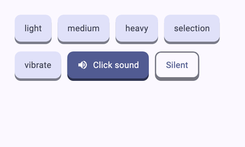
</p>

**What it does:** a short vibration when pressed, in one of five strengths, and an optional click sound. A screenshot can't show a vibration, so try these on a phone in the example app.

**When it helps:** to confirm a tap without looking, in games, and for important actions.

**How to use it:**

```dart
BouncyButton(
  onPressed: () {},
  interaction: const BouncyButtonInteraction(
    hapticFeedbackType: BouncyHapticFeedbackType.medium,
    enableSound: true,
  ),
  child: const Text('Feel it'),
)
```

**Out of the box:**
- **Haptics:** a light vibration on every tap, on phones that support it. Keyboard and screen reader presses don't vibrate.
- **Sound:** none.

**What you can change:**

| Option | What it changes | Default |
| --- | --- | --- |
| `enableHapticFeedback` | Vibration on a tap | `true` |
| `hapticFeedbackType` | `light`, `medium`, `heavy`, `selection`, or `vibrate` | `light` |
| `enableSound` | The system click. Some platforms have none, and web plays nothing | `false` |
| `onPressSound` | Plays your own sound, such as with an audio package | None |
| `enableSplash`, `splashColor`, `splashFactory` | A Material ripple on the face | Off |
| `highlightColor` | The ripple's highlight, and the tint of a pressed ghost or glass button | A faint tint of the text color |
| `hoverColor`, `focusColor`, `cursor` | Mouse and keyboard highlights, and the mouse cursor | A tint of the text color, the text color, a pointing hand |

### Test your buttons

**What it does:** one line in a widget test checks that a button works for everyone.
- **Semantics:** it's announced as a button with a label.
- **Size:** it's big enough to tap.
- **Contrast:** its text is readable.
- **Double taps:** with `pressCount`, a quick double tap and a held Enter key each run it only once.

**When it helps:** to keep buttons accessible as your app changes.

**How to use it:**

```dart
import 'package:bouncy_button/testing.dart';

testWidgets('Pay is accessible', (tester) async {
  var payments = 0;
  await tester.pumpWidget(MyCheckout(onPay: () async => payments++));
  await expectAccessibleButton(
    tester,
    find.text('Pay'),
    pressCount: () => payments,
  );
});
```

**Out of the box:** it runs Flutter's tap target, label, and text contrast checks on the whole screen. A failure explains the problem, for example "A quick double tap ran the action 2 times. Add a cooldown, or use onPressedAsync".

**What you can change:**

| Option | What it changes | Default |
| --- | --- | --- |
| `pressCount` | Also checks double taps and a held Enter key | Not checked |
| `checkContrast` | Turn off the contrast check | `true` |

## Complete reference

Every public option, with its default. The full API documentation is on [pub.dev](https://pub.dev/documentation/bouncy_button/latest/).

### BouncyButton

Constructors: `BouncyButton`, `BouncyButton.primary`, `.secondary`, `.tertiary`, and `.icon`. They differ only in their default style. `.icon` takes `icon` and a required `tooltip` instead of `child`, and has no `semanticLabel`, `builder`, `leading`, `trailing`, or `gap`.

| Option | What it does | Default |
| --- | --- | --- |
| `child` | The label, usually a `Text` or `Icon` | Required |
| `onPressed` | Runs on a tap or keyboard press | None |
| `onPressedAsync` | An async action, with loading, success, and error | None |
| `onError` | Receives errors from `onPressedAsync`, `confirm`, and timeouts | Reported to Flutter |
| `isLoading` | Shows loading, for loading you track yourself | None |
| `feedback` | Loading, success, and error options | Theme's, then built-in |
| `cooldown` | Ignores taps for a while after each use | None |
| `timeout` | How long `onPressedAsync` may run | None |
| `confirm` | Asked before the action. It runs only on `true` | None |
| `controller` | Presses, resets, and follows the button from code | None |
| `tooltip` | A name on hover, long press, and keyboard focus, read by screen readers | None |
| `disabledReason` | Why the button is disabled, as a tooltip and to screen readers | None |
| `isSelected` | Makes a toggle | Not a toggle |
| `expanded` | Whether the menu it opens is showing | Opens nothing |
| `semanticLabel` | Replaces what screen readers read | The child's text |
| `onLongPress`, `onTapDown`, `onTapUp`, `onTapCancel` | Other touch callbacks | None |
| `hitTestBehavior` | Which parts take taps | The whole box |
| `style`, `animation`, `interaction` | Look, motion, and touch feedback | Theme's, then built-in |
| `enabled` | Turns the button off | `true` |
| `focusNode`, `autofocus` | Keyboard focus | None, `false` |
| `statesController` | Follows pressed, hovered, focused, disabled, and selected | None |
| `builder` | Your own content, told whether the button is pressed | None |
| `leading`, `trailing`, `gap` | Icons around the label, and the space between | None, None, `8` |

The button is disabled when `enabled` is `false`, or it has no `onPressed`, `onPressedAsync`, or `onLongPress`.

### BouncyButtonStyle

| Option | What it does | Default |
| --- | --- | --- |
| `height` | Smallest face height. Circles are exactly this tall | `60` |
| `width` | Fixed width | Fits the label. A circle is as wide as it is tall |
| `minWidth` | Smallest width | None |
| `elevation` | Depth of the press | `8` |
| `fill` | `filled`, `tonal`, `outlined`, `ghost`, or `glass` | `filled` |
| `tone` | `normal` or `destructive` | `normal` |
| `backgroundColor` | Face color. For `outlined` and `ghost`, the text and border color. For `glass`, the tint | Filled: primary. Tonal: secondary container. Outlined and ghost: primary text, with an `outline` border. Glass: a see-through surface tint. Error colors with the destructive tone |
| `foregroundColor` | Text and icon color | Readable on the face |
| `disabledColor` | Face color when disabled. For `outlined` and `ghost`, the text color | Filled: grey. Tonal: a light grey. Outlined and ghost: faded text. Not used by glass |
| `hslColor` | Face color as HSL | None |
| `gradient`, `disabledGradient` | A gradient face, and when disabled | None, a darker gradient |
| `shadowColor`, `shadowDarkness` | The depth layer's color, or how much darker than the face | Generated, `0.3` |
| `shadow`, `shadows` | Soft shadows around the face | None |
| `borderRadius`, `pressedBorderRadius` | Corners at rest and when pressed | `12`, no change |
| `border` | A border | None. Outlined and glass draw their own |
| `shape` | `BoxShape.rectangle` or `circle` | Rectangle |
| `padding`, `margin` | Space inside, and outside | 24 by 12, none |
| `textStyle`, `iconSize` | Text style and icon size | Theme's |
| `alignment` | Where the content sits | Center |
| `opacity` | Transparency | `1` |
| `transform`, `transformAlignment` | Rotate, scale, or skew the button | None |
| `clipBehavior` | Clips the content to the face | None |
| `decoration`, `shadowDecoration` | Full control of the face and the depth layer | None |
| `minTapTarget` | Smallest tap area | The button's size |

**Presets:**

| Preset | Height | Depth | Corners | Notes |
| --- | --- | --- | --- | --- |
| `BouncyButtonStyle.primary` | 56 | 8 | 12 | |
| `BouncyButtonStyle.secondary` | 48 | 6 | 8 | |
| `BouncyButtonStyle.flat` | 46 | 2 | 6 | Used by `.tertiary` |
| `BouncyButtonStyle.pill` | 48 | 6 | 24 | |
| `BouncyButtonStyle.tonal` | 48 | 6 | 12 | Tonal fill |
| `BouncyButtonStyle.outlined` | 48 | 4 | 12 | Outlined fill |
| `BouncyButtonStyle.ghost` | 48 | 0 | 12 | Text only |
| `BouncyButtonStyle.destructive` | 48 | 6 | 12 | Error colors |
| `BouncyButtonStyle.glass` | 48 | 0 | 16 | Frosted glass |
| `BouncyButtonStyle.icon` | 48 | 4 | Circle | Tonal, 48 tap area. Used by `.icon` |
| `BouncyButtonStyle.circle` | 56 | 8 | Circle | 56 wide |
| `fromSize(small, medium, large)` | 44, 48, 56 | 4, 6, 8 | 10, 12, 14 | Text 14, 16, 18. Icons 18, 20, 24 |
| `simple(color, foregroundColor, width, height, borderRadius, depth, shadowDarkness)` | `48` | `6` | `12` | Shadow darkness `shadowLight` |

`BouncyButtonStyle.shadowLight` is 0.12, and `shadowDark` is 0.3.

### BouncyButtonAnimation

| Option | What it does | Default |
| --- | --- | --- |
| `type` | `depth`, `scale`, `rotation`, `bounce`, `fade`, or `slide` | `depth` |
| `duration`, `reverseDuration` | Press and release speed | 70 ms, same as press |
| `curve`, `reverseCurve` | Press and release feel | `Curves.easeInOut`, same as press |
| `scaleAmount` | Size for `scale` and `bounce` | `0.95` |
| `rotationAngle` | Tilt for `rotation`, in radians | `0.03` |
| `animateOpacity` | Fades a disabled button to 60%, smoothly | `false` |
| `spring` | Spring physics, which replaces durations and curves | None |

**Presets:** `quick` (50 ms, ease out), `smooth` (150 ms, ease in-out cubic), `springy` (bounce with the `bouncy` spring), and `bouncy` (90 ms in, 450 ms out, elastic release).

**BouncyPressSpring:** `stiffness` `500`, `dampingRatio` `0.5`, and `mass` `1`. Presets: `snappy` (900, 0.75), `bouncy` (500, 0.4), and `gentle` (200, 1).

### BouncyButtonInteraction

| Option | What it does | Default |
| --- | --- | --- |
| `enableHapticFeedback`, `hapticFeedbackType` | Vibration on a tap | `true`, `light` |
| `enableSound`, `onPressSound` | System click, or your own sound | `false`, none |
| `enableSplash`, `splashColor`, `splashFactory` | Material ripple | Off |
| `highlightColor` | The ripple's highlight, and the tint of a pressed ghost or glass button | A faint tint of the text color |
| `hoverColor` | Overlay under a mouse | A faint tint of the text color |
| `hoverLift` | How far the face rises under a mouse | `2` |
| `focusColor` | Keyboard focus ring color | The text color |
| `cursor` | Mouse cursor | Pointing hand, or an arrow when disabled |

### BouncyButtonFeedback

| Option | What it does | Default |
| --- | --- | --- |
| `loadingBuilder`, `successBuilder`, `errorBuilder` | Your own content for each state | Spinner, tick, error icon |
| `loadingText` | Text next to the spinner | None |
| `showSuccess`, `showError`, `shakeOnError` | Which results show, and the shake | `true`, `true`, `true` |
| `resultDuration` | How long results stay | 1.2 seconds |
| `minLoadingDuration` | Shortest loading time | 0 |
| `loadingLabel`, `successLabel`, `errorLabel` | What screen readers say | "Loading", "Done", "Failed" |

### BouncyPressable

| Option | What it does | Default |
| --- | --- | --- |
| `child`, `onTap` | The widget, and what a tap does. A null `onTap` and `onLongPress` turn it off | Required |
| `onLongPress`, `onTapDown`, `onTapUp`, `onTapCancel` | Other touch callbacks | None |
| `enabled` | Turns it off | `true` |
| `scaleFactor` | Size while pressed | `0.95` |
| `duration`, `reverseDuration`, `curve`, `reverseCurve` | Press and release motion | 120 ms, same, `easeOut`, same |
| `spring` | Spring physics | None |
| `haptic`, `enableSound`, `onPressSound` | Vibration and sound | None, `false`, none |
| `cooldown` | Ignores taps after each use | None |
| `cursor`, `hitTestBehavior` | Mouse cursor, and which parts take taps | Pointing hand, the whole box |
| `focusNode`, `autofocus`, `focusColor`, `focusBorderRadius` | Keyboard focus and its ring | None, `false`, blue, 8 |
| `semanticLabel`, `semanticsButton` | What screen readers hear, and whether it's one button | None, `true` |
| `isSelected`, `expanded` | Toggle state, and menu state | None |
| `statesController` | Follows its states | None |

### BouncyAsyncBuilder

| Option | What it does | Default |
| --- | --- | --- |
| `onPressed` | The async action. If null, `builder` gets a null callback | Required |
| `builder` | Builds your button from the guarded callback and the status | Required |
| `onError`, `cooldown`, `controller`, `timeout`, `confirm` | As on `BouncyButton` | None |
| `feedback` | Timings and screen reader labels. Its builders aren't used | Built-in. The theme's `defaultFeedback` isn't used |
| `disableWhileBusy` | Passes a null callback while busy | `false` |
| `announceStatus` | Screen readers hear status changes | `true` |

### BouncyButtonGroup and BouncyButtonSegment

| Option | What it does | Default |
| --- | --- | --- |
| `segments`, `selected`, `onSelectionChanged` | The options, the chosen values, and what happens on a change. A null callback turns the group off | Required |
| `multiSelect`, `emptySelectionAllowed` | Several choices, and choosing none | `false`, `false` |
| `style`, `selectedStyle` | Unselected and selected looks | Medium tonal, filled |
| `interaction` | Haptics and highlights | Selection click |
| `spacing`, `expand` | Gap, and sharing the width | `2`, `true` |
| `showSelectedIcon`, `selectedIcon` | A check on selected segments | `false`, a check mark |
| Segment `value`, `label`, `icon` | The value, and what shows. Needs a label or an icon | Required, None, None |
| Segment `enabled`, `semanticLabel` | Turning one off, and a screen reader label | `true`, None |

### Control and themes

| Class | Options | Default |
| --- | --- | --- |
| `BouncyButtonController` | `press()`, `reset()`, `status`, `isAttached`. Listen to it to follow `status`, and dispose it when done | |
| `BouncyExclusiveScope` | `lockDuringLoading`, `child` | `false` |
| `BouncyButtonTheme` | `primaryStyle`, `secondaryStyle`, `tertiaryStyle`, `iconStyle`, `defaultAnimation`, `defaultInteraction`, `defaultFeedback`. Add it to `ThemeData.extensions` | None |
| `BouncyButtonScope` | `theme`, `child`. A theme without the Material `Theme` | |

**How settings are looked up:** `style`, `animation`, `interaction`, and `feedback` are each used as a whole, never merged. A button uses its own value. Otherwise it uses the nearest `BouncyButtonScope`'s theme, or, without a scope, the `BouncyButtonTheme` in `ThemeData.extensions`. Otherwise it uses the built-in default. So a scope replaces the Material theme's `BouncyButtonTheme` completely, and a `style` passed to one button replaces the whole themed style, so copy what you need from it with `copyWith`.

### Helpers and enums

| Name | What it does |
| --- | --- |
| `BouncyButtonColors.gradientFromColor(color, spread: 0.2, begin, end)` | A gradient from a lighter to a darker shade of one color |
| `BouncyButtonColors.darken(color, [0.12])`, `lighten(color, [0.12])` | A darker or lighter shade |
| `BouncyButtonColors.complementary`, `analogous(count: 3)`, `triadic`, `tetradic`, `monochromatic(count: 5)` | Matching color palettes |
| `gradient.scaleLightness(factor)` | A lighter or darker copy of a gradient |
| `BouncyButtonAnimationType` | `depth`, `scale`, `rotation`, `bounce`, `fade`, `slide` |
| `BouncyButtonFill` | `filled`, `tonal`, `outlined`, `ghost`, `glass` |
| `BouncyButtonSize` | `small`, `medium`, `large` |
| `BouncyButtonStatus` | `idle`, `loading`, `success`, `error` |
| `BouncyButtonTone` | `normal`, `destructive` |
| `BouncyHapticFeedbackType` | `light`, `medium`, `heavy`, `selection`, `vibrate` |
| `debugBouncyChecksEnabled` | Turns the debug warnings on or off. Default `true` |
| `expectAccessibleButton(tester, finder, {pressCount, checkContrast: true})` | The test helper, from `package:bouncy_button/testing.dart` |

**Deprecated:** `HapticFeedbackType` is now `BouncyHapticFeedbackType`, and `GradientExtension` is now `BouncyGradientExtension`, with its `scale` method renamed `scaleLightness`. The old names still work, but note that `gradient.scale(x)` calls Flutter's own `Gradient.scale`, which fades the colors, rather than this package's method.

**Libraries:** `package:bouncy_button/bouncy_button.dart` has everything. `package:bouncy_button/pressable.dart` has, without Material, `BouncyPressable`, `BouncyAsyncBuilder`, `BouncyButtonController`, `BouncyExclusiveScope`, `BouncyPressSpring`, `BouncyButtonFeedback`, `BouncyButtonStatus`, `BouncyHapticFeedbackType`, and `debugBouncyChecksEnabled`. `package:bouncy_button/testing.dart` has the test helper.

## Example app

The [example app](https://github.com/Ibrahim-Lokman/bouncy_button/tree/main/example) runs on built-in sample data, so it needs no setup:

```sh
cd example
flutter run
```

| Tab | What it shows |
| --- | --- |
| **Features** | Every feature above, in the same order, with a live demo. "See every option" at the end opens a gallery of every style and setting |
| **Shop** | Product cards with favorites, and loading, empty, and error states |
| **Checkout** | A payment that can succeed, fail, time out, and retry without charging twice |
| **Playground** | Sliders and switches for height, depth, corners, timing, shadow, fill, color, animation type, and spring, with the code to copy |
| **Settings** | Mock network speed and failures, theme, text size, right to left, and reduce motion |

The screenshots and animations in this README are recorded from the Features tab. To record them again after changing it, run `example/tool/make_gifs.sh`, which needs `ffmpeg`.

## Upgrading

### From 2.1 to 2.2

Nothing needs to change in your code. A few things work differently:

- **Held keys:** holding Enter or Space on a button presses it once, instead of repeating.
- **Timing with animations off:** when the system turns animations off, `cooldown`, `minLoadingDuration`, and `resultDuration` now keep their full length. Before, Flutter shortened them to 5%.
- **Spinner color:** the loading spinner now matches the button's text, so it's visible on dark buttons.
- **Focus ring:** it's 3 pixels wide instead of 2 in high contrast mode.
- **Button groups:** segments are announced as "checked" or "not checked", like Flutter's `SegmentedButton`. Tests that look for a selected flag on a segment should check `isChecked` instead.
- **Warnings:** your debug console may show the new warnings. Each one describes a real problem, but you can turn them off with `debugBouncyChecksEnabled = false`.

### From 1.x to 2.0

- **Width:** a button with no `width` now fits its label. Add `width: double.infinity` where it should fill the space.
- **Dragging:** sliding your finger off the button now cancels the press, like Material buttons.
- **Text color:** text now picks a color that's readable on the button. Set `foregroundColor` to choose your own.
- **Long press only:** a button with only `onLongPress` is now enabled. Set `enabled: false` to disable it.

See the [changelog](https://github.com/Ibrahim-Lokman/bouncy_button/blob/main/CHANGELOG.md) for everything else.

### Migration examples

#### Example A: a press effect on any widget

```dart
// Before
Bounceable(onTap: open, scaleFactor: 0.9, child: card)

// After
BouncyPressable(onTap: open, scaleFactor: 0.9, child: card)
```

The timing and callback options keep their names. The default `scaleFactor` is 0.95.

#### Example B: blocking repeat taps on an existing button

```dart
// Before
TapDebouncer(
  onTap: () => api.save(),
  cooldown: const Duration(seconds: 1),
  builder: (context, onTap) => ElevatedButton(onPressed: onTap, child: const Text('Save')),
)

// After
BouncyAsyncBuilder(
  onPressed: () => api.save(),
  cooldown: const Duration(seconds: 1),
  builder: (context, onPressed, status) => ElevatedButton(onPressed: onPressed, child: const Text('Save')),
)
```

To disable the button while it's busy, set `disableWhileBusy: true`.

#### Example C: a 3D button from a few values

```dart
// Before
AnimatedButton(
  onPressed: save,
  color: Colors.blue,
  width: 200,
  shadowDegree: ShadowDegree.dark,
  child: const Text('Save'),
)

// After
BouncyButton(
  onPressed: save,
  style: BouncyButtonStyle.simple(
    color: Colors.blue,
    width: 200,
    shadowDarkness: BouncyButtonStyle.shadowDark,
  ),
  child: const Text('Save'),
)
```

## Contributing

Bug reports, ideas, and pull requests are welcome. See the [contributing guide](https://github.com/Ibrahim-Lokman/bouncy_button/blob/main/CONTRIBUTING.md) to get started, and please follow the [code of conduct](https://github.com/Ibrahim-Lokman/bouncy_button/blob/main/CODE_OF_CONDUCT.md).

## License

MIT. See [LICENSE](https://github.com/Ibrahim-Lokman/bouncy_button/blob/main/LICENSE).

## Author

Made by **Ibrahim Lokman** in Bangladesh. Find me on [GitHub](https://github.com/Ibrahim-Lokman) or [LinkedIn](https://www.linkedin.com/in/ibrahim-lokman/), or [email me](mailto:ibrahimlokman.bd@gmail.com).

If Bouncy Button helps you, a ⭐ on [GitHub](https://github.com/Ibrahim-Lokman/bouncy_button) or a 👍 on [pub.dev](https://pub.dev/packages/bouncy_button) helps others find it.
